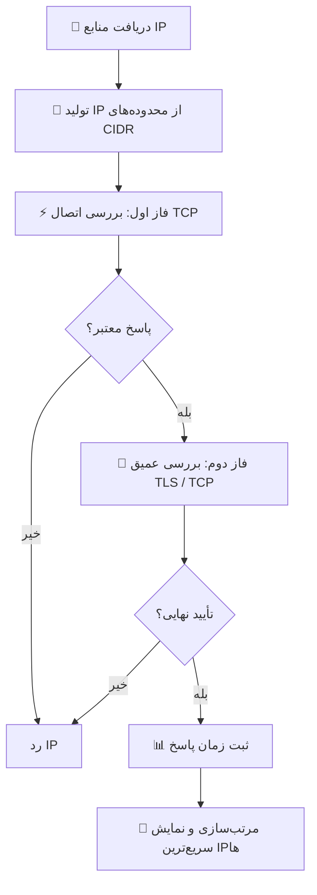

<div align="center">



<br/>

<a href="https://github.com/IRNova/NovaRadar">
  
</a>


<br/><br/>


<br/>

[معرفی](#معرفی) · [ویژگی‌ها](#ویژگیها) · [نحوه-کار](#نحوه-کار) · [منابع-IP](#منابع-ip) · [حمایت](#حمایت-از-پروژه)

</div>

---

## <a id="معرفی"></a>🛰️ معرفی نوا رادار

**Nova Radar** یک ابزار دسکتاپ برای اسکن و ارزیابی IPهای مرتبط با Cloudflare است. این برنامه با استفاده از **Wails v3، Go و React / TypeScript** توسعه داده شده و IPهای پاسخ‌گو را پس از بررسی اتصال، بر اساس سرعت پاسخ مرتب می‌کند.

هدف نوا رادار این است که فرایند پیدا کردن IPهای سالم را ساده‌تر، سریع‌تر و قابل‌کنترل‌تر کند؛ از انتخاب منابع و پورت‌ها تا مشاهده زنده روند اسکن و خروجی گرفتن از نتایج.

<div align="center">

| ⚡ اسکن سریع | 🧪 اعتبارسنجی عمیق | 📊 مرتب‌سازی هوشمند |
|:---:|:---:|:---:|
| بررسی اتصال TCP | بررسی TLS و پاسخ پروتکل | نمایش سریع‌ترین IPها در ابتدا |

</div>

## <a id="ویژگیها"></a>✨ قابلیت‌ها

- **اسکن چندمنبعی:** پشتیبانی از ۹ منبع قابل انتخاب شامل منابع رسمی Cloudflare، ASNها، فهرست CM، پراکسی معکوس و دامنه‌های داخل و خارج.
- **اعتبارسنجی دو مرحله‌ای:** ابتدا بررسی سریع TCP و سپس تست عمیق TLS یا TCP متناسب با نوع پورت.
- **رتبه‌بندی بر اساس سرعت:** مرتب‌سازی IPهای تأییدشده از کمترین زمان پاسخ به بیشترین.
- **نمایش زنده فرایند:** نمایش IP در حال بررسی، نوار پیشرفت، زمان تخمینی و تعداد موارد اسکن‌شده، زنده و مرده.
- **انتخاب پورت:** امکان انتخاب از میان ۱۲ پورت پشتیبانی‌شده.
- **خروجی آسان:** کپی نتایج در کلیپ‌بورد یا ذخیره آن‌ها در فایل متنی `.txt`.
- **رابط کاربری مدرن:** تم تاریک، رادار متحرک و تجربه دسکتاپ یکپارچه.
- **پنجره اختصاصی:** پنجره بدون فریم با نوار عنوان سفارشی و System Tray.

## <a id="نحوه-کار"></a>⚙️ روند عملکرد

<div align="center">



</div>

1. **دریافت منابع:** هنگام شروع اسکن، منابع IP فعال به‌صورت موازی از GitHub دریافت می‌شوند.
2. **تولید IP:** آدرس‌های IP از محدوده‌های CIDR به‌صورت تصادفی تولید می‌شوند (حداکثر ۵۱۲ مورد).
3. **اسکن سریع — فاز اول:** اتصال TCP به هر IP و پورت با آفست تصادفی و حداکثر ۸۰۰ کارگر هم‌زمان بررسی می‌شود.
4. **تست عمیق — فاز دوم:** برای پورت‌های امن، TLS و برای پورت‌های HTTP، پاسخ TCP بررسی می‌شود؛ تست با ۳ تلاش و شرط قبولی حداقل ۲ بار موفقیت انجام می‌شود.
5. **مرتب‌سازی:** IPهای تأییدشده بر اساس زمان پاسخ مرتب و نمایش داده می‌شوند.

## <a id="منابع-ip"></a>🌐 منابع IP

| منبع | نوع | توضیحات |
|:---|:---:|:---|
| Cloudflare Official | `CIDR` | محدوده‌های رسمی از `cloudflare.com/ips-v4` |
| لیست CM | `CIDR` | فهرست محدوده‌های CIDR کلودفلر |
| AS13335 | `ASN` | شبکه کلودفلر |
| AS209242 | `ASN` | شبکه کلودفلر |
| AS24429 | `ASN` | شبکه علی‌بابا |
| AS199524 | `ASN` | شبکه G-Core |
| آی‌پی پراکسی معکوس | `Proxy IP` | آدرس‌های پراکسی عمومی |
| دامنه خارج | `Domain` | دامنه‌های خارجی |
| دامنه ایران | `Domain` | دامنه‌های ایرانی |

## 🔌 پورت‌های قابل بررسی

`443` · `2053` · `2083` · `2087` · `2096` · `8443` · `80` · `2052` · `2082` · `2086` · `2095` · `8080`

## 🧰 فناوری‌های استفاده‌شده

<div align="center">


</div>

- **Backend:** Go 1.25
- **Desktop Runtime:** Wails v3 alpha
- **Frontend:** React 19 و TypeScript

## 💜 <a id="حمایت-از-پروژه"></a>حمایت از پروژه

اگر نوا رادار برای شما مفید بوده، می‌توانید با حمایت مالی به ادامه توسعه و نگهداری پروژه کمک کنید.

<div align="center">

<a href="https://daramet.com/NovaPr">
  
</a>

<br/><br/>

**درگاه حمایت:** [daramet.com/NovaPr](https://daramet.com/NovaPr)

</div>

<details>
<summary><b>💳 آدرس کیف پول‌ها</b></summary>

**BTC**
```text
bc1qc54su3gz20ulq8df7k0pcskk4zz4sy0e7z7hws
```

**TON**
```text
UQD51lGC35rP_SbVYgbFA7CEEii4GVMFgqj4N8fiGi6m425w
```
</details>

## ⭐ ستاره‌های پروژه

از نوا رادار در GitHub حمایت کنید و برای دنبال‌کردن رشد پروژه، تاریخچه ستاره‌ها را ببینید.

<div align="center">

<a href="https://star-history.com/#IRNova/NovaRadar&Date">
  
</a>

</div>

## 📜 مجوز و مسئولیت استفاده

این پروژه صرفاً برای اهداف آموزشی ارائه شده است. مسئولیت نحوه استفاده از ابزار بر عهده کاربر است.

---

<div align="center">

### NOVA PROXY

**مهندسی‌شده با دقت؛ توسعه‌یافته در گروه نوا پروکسی.**

<a href="https://github.com/IRNova">GitHub</a> ·
<a href="https://t.me/irnova_proxy">Telegram</a> ·
<a href="https://t.me/irnovaproxy">Community</a>

<br/>


</div>
